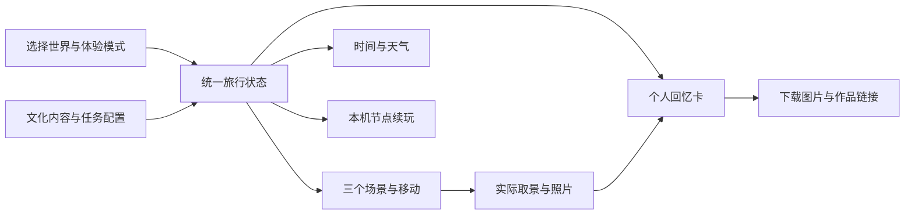

# 此间｜两日项目规划书

版本：0.9 决策与执行建议版  
编制日期：2026-11-01（北京时间）  
面向：三人团队「三径」、Claude、Codex及后续参与制作的 Agent  
配套文件：[任务清单与工作流](./此间_任务清单与工作流.md)、[Agent执行手册](./此间_Agent执行手册.md)、[调研与选型依据](./此间_调研与选型依据.md)

> 本文件是制作方案，不是作品已实现的说明。已有最小模型由队员使用 Claude 跑通，但本次没有拿到其源码、技术栈或预览地址，尚未进行工程审查。主办方允许独立网页或其他互动作品，已由用户确认。本文中的效果、性能和时间均为制作目标，需以实测验收。

## 1. 建议团队采用的方案

**产品长期定位：高审美、可交互的沉浸式文化旅行。两日首发：一个完整文化章节，三个相连场景，两条共享场景的轻主线，晴／雨两套天气，真实游戏内拍照和个人回忆卡。**

推荐首发题材：**《此间·湖山一日》——以杭州西湖南岸、长桥望雷峰塔的景观关系为依据，制作经过空间压缩的当代文化旅行片段。**

推荐交付：优先延续现有最小模型，交付可通过链接打开的电脑端网页。若已有工程采用 Three.js 或 React Three Fiber，就在原栈上完成，不为套用本规划而重写。第一小时由原型制作者确认运行方法、渲染器和已实现功能。

推荐组织：A负责技术整合与发布，B负责场景与视觉，C负责文化内容、交互界面及体验测试。每人都可以使用 Claude 与 Codex，但每项任务只有一个主写者，另一个 Agent 做审查或定位问题。

### 1.1 现在可以执行的五项建议

1. 首发只开放一个文化世界；其他世界可以出现在选择页，但清楚标为「筹备中」。
2. 先做一处代表最终画质的运行小样，再决定是否继续杭州方案。
3. 任务、天气、时间与回忆卡共用一套状态，不各写一套演示逻辑。
4. 拍照是核心玩法，第一天就验证真实截图、保存和卡片合成。
5. 第一天结束前必须得到可从进入走到回忆卡的版本；第二天主要用于内容、美术、性能和现场体验。

### 1.2 两日范围与长期愿景

| 内容 | 两日首发 | 后续扩展 |
|---|---|---|
| 世界数量 | 1个可玩世界，其他入口明确标注状态 | 杭州、西安、东京或富士山周边、巴黎等独立章节 |
| 空间 | 3个相连的精做场景 | 增加街区、建筑内部和路线 |
| 主线 | 2条轻主线共享地点与基础资产 | 各章独立任务体系、更多结局 |
| 生活支线 | 1个完成度高的生活互动；另2个短观察点作为P1增强 | 中国酒楼、日本酒吧／居酒屋、法国咖啡馆等分别归属对应文化世界 |
| 时间 | 早晨、午后、傍晚、夜晚4个事件驱动阶段 | 更细的连续昼夜与日程 |
| 天气 | 晴与小雨2套可验证的预设 | 更多天气、季节和天气关联事件 |
| 角色 | 2位有短对话的人物，可用低动画成本方式表现 | 更多人物与动态行为 |
| 拍照 | 3个推荐机位、自由取景、至少1张玩家实拍进入回忆卡 | 镜头语言、更多构图玩法 |
| 体验时长 | 快速体验目标2—3分钟；完整探索目标10—20分钟，试玩后校准 | 更多章节带来更长内容 |
| 分享 | 下载真实回忆卡、复制作品链接 | 云端相册、公开旅行回忆页 |
| 手机 | 首屏、项目介绍、回忆卡查看与电脑体验提示 | 真正经过触控与性能适配的移动游玩 |

**不把杭州、东京酒吧和巴黎咖啡馆塞进同一条街。** 跨文化生活节点按世界分开制作，统一的是交互方式、叙事结构和回忆卡系统。

## 2. 已确认信息与开工核验

### 2.1 已确认

- 团队3人、3台电脑，总周期2天，可投入时间较多。
- 目标以最终体验效果为主，token成本不是主要约束；其他资源支出由团队决定。
- 通过 Claude、Codex进行 AI 辅助开发，可使用 Blender、图像生成等工具。
- 已有由队员跑通的最小模型；源码与技术栈尚未提供。
- 用户第一目标是身临其境地探索发现，第二目标是认识当地文化与生活。
- 视觉要求为经过审美化处理的写实电影感，重视地貌、建筑和文化依据。
- 自由行走、打卡拍照、天气是重点要求。
- 允许独立网页或其他互动作品；核心交付物必须可实际体验。
- 主要电脑端，需要让评委快速打开，并考虑分享与后续使用。

### 2.2 开工首小时必须核验

| 信息 | 负责人 | 取得证据 | 对计划的影响 |
|---|---|---|---|
| 现有工程路径与技术栈 | A，向原型制作者获取 | 运行说明、项目目录、成功运行画面 | 决定原栈延续方式 |
| 实际提交时刻与提交方式 | C | 活动群通知或工作人员答复 | 把相对排期换成真实时刻 |
| 目前能走、能互动到何种程度 | A | 同一版本的操作录像与功能记录 | 决定先补哪一段链路 |
| 城市主体资产能否获得 | B | 可导入的候选资产与来源记录 | 决定城市是否锁定 |
| 三台电脑的代表性设备 | A | 分辨率、浏览器、显卡／内存信息及帧率记录 | 决定实际质量档 |
| 快速试玩与完整体验是否都需提交 | C | 主办方要求记录 | 决定入口与展示路径 |

暂用A／B／C代号，不假定任何成员已经掌握编程或美术。角色可在前30分钟互换，但整合负责人只能有一位。

## 3. 城市选题比较与选择规则

以下是针对「三人、两天、电影感写实、文化旅行」的设计判断，不是对真实城市价值的排名，也不是未经验证的素材可得性评分。

| 候选 | 可以成立的片段 | 现场吸引点 | 制作压力 | 建议 |
|---|---|---|---|---|
| 杭州西湖 | 湖岸—生活节点—长桥方向观景 | 水面、柳岸、天气、夕照可以形成统一画面 | 水与植被需要调优；文化不能只剩诗词贴板 | 默认首发候选 |
| 西安 | 大雁塔周边—唐风街区片段—夜景收束 | 夜晚点灯、建筑轮廓，视觉识别明确 | 仿唐建筑、装饰、人流和多灯光较重 | 有高质量现成资产时优先复评 |
| 巴黎 | 某一段河岸或铁塔附近的明确区域 | 地标、日落、咖啡生活 | 地标与街区资产要统一，空间关系需核对 | 已有可用资产时可替换杭州 |
| 东京 | 一处具体街区，而非整个东京 | 夜间街道、日常人物与店铺 | 密集立面、文字招牌、生活细节较多 | 后续都市章节 |
| 富士山周边 | 河口湖等明确地点的观景片段 | 富士山、湖面、季节性樱花 | 季节与视点须统一；远山轮廓和植物要可信 | 若最爱富士樱花，可替代「东京」候选 |
| 风车牧场 | 先选具体地区再研究 | 风车、草地、天空、风声 | 文化目标目前不清楚，不能靠符号拼接 | 后续主题，不进入首发 |

### 3.1 为什么默认推荐杭州

UNESCO对西湖的介绍强调湖山、堤岛、亭台和景观营造形成的文化价值，这与探索、观察、取景的玩法有直接联系。官方杭州资料也展示了长桥观雷峰塔的景观关系。因此可以把文化内容放进「如何看见一处风景」，减少生硬问答。[UNESCO西湖文化景观](https://whc.unesco.org/en/list/1334/)、[长桥与雷峰夕照](https://www.hzxcw.gov.cn/content_47987.html)

湖岸、树木、材质和远景可拆分制作，建筑工作量有机会收在一个关键地标上。这里的「有机会」必须由运行小样验证；目前尚未确认已找到足够好的杭州整套场景。

### 3.2 文化与地理边界

- 「富士山下樱花」应明确选择富士山周边地点。JNTO列举河口湖等观景位置，不能把这类场景直接标为东京市区。[JNTO观富士山地点](https://www.japan.travel/en/fuji-guide/views-of-fuji/)
- 大唐不夜城以仿唐建筑和当代文旅体验为特点。若采用该题材，默认是当代西安的唐风夜游，不宣称其等于唐代长安的精确复原。[曲江新区资料](https://qjxq.xa.gov.cn/zwgk/ndzdxxgk/ggwh/1873997477139513345.html)
- 巴黎铁塔、咖啡馆、河岸的相邻关系要由参考地图与影像核对。进行空间压缩时，产品介绍明确写「基于真实地点的艺术化压缩」。
- 同一章节固定一个季节。天气可变，但不把春樱、夏荷、秋叶和冬雪同时当成同一天的真实景观。
- 真实地名、文化事实、传说与原创人物对白分别标记。艺术加工不能被写成事实来源。

### 3.3 城市锁定方法：T=2小时前完成

B对杭州和最有现成资产的一个备选做快速检查。每个候选最多45分钟，只做入口到一个推荐机位的运行小样，不制作完整城市。

通过条件：素材能合法用于项目、能导入运行、核心地标与环境相容、从玩家视角有一张能代表作品方向的画面、代表设备运行可接受。两者都通过时优先选现有MVP改动更小的一项。没有通过时，缩小到一个地点的三个可步行区域；不继续在五个城市之间反复切换。

## 4. 首发章节设计：湖山一日

### 4.1 空间骨架

世界定位：当代杭州西湖南岸景观的艺术化片段。以长桥方向观景关系作为落点，不宣称一比一地图复刻。

| 场景 | 玩家行为 | 文化内容 | 视觉任务 | 实现边界 |
|---|---|---|---|---|
| S01 柳岸抵达 | 行走、观察地图、与引导人物说话、选择主线、拍第一张照片 | 认识这是经过长期营造的文化景观 | 柳枝近景、湖面中景、山线远景，入口即有完整构图 | 不做大型交通站和复杂人群 |
| S02 湖畔停留 | 继续所选主线、体验一次生活互动、完成轻任务 | 景观欣赏或杭州茶生活的一个可核实细节 | 小尺度坐席、道具与声音，构图更亲近人 | 茶叙点是原创互动节点，不冒充某真实名店 |
| S03 临湖收束 | 傍晚作选择、移动到观景位、拍照、进入夜晚回忆 | 了解所见地标／景观关系，辨别事实与传说 | 地标轮廓、夕照与夜色；同一场景完成时间变化 | 地标比例和视向由资料核对，不随意造塔 |

三个区域用真实可行走的地面连接，可以通过转角、树丛和坡度分隔视线。优先一张小地图，不做三个完全独立引擎场景的加载系统。远处不可到达区域以明确环境边界表达。

### 4.2 时间与季节

首版建议设定为一个温和季节的典型日，参考图、植被、服装和声音统一；具体季节由视觉小样与文化资料共同冻结。

四个时间阶段：早晨→午后→傍晚→夜晚。推进由任务节点触发，并给用户「继续停留／前往下一时段」的选择。用户不操作时不会因计时错过剧情；旁白可跳过，文字可回看。

同一季节内晴／小雨切换。小雨至少体现粒子或雨幕、雨声、天空／光照与地面观感变化；不要求复杂积水模拟。切换天气不重置主线，也不把已拍照片自动改成新天气。

### 4.3 两条主线，共享三个场景

玩家在S01的引导对话后选择主线，再执行对应任务。S02继续所选路线，不在这里首次选择主线。

**主线A「寻景」：用观察和取景认识地方。**

1. S01从两个相近位置选取一张湖岸照片，保存实际镜头。
2. S02接受一条简短构图提示，发现近景、中景、远景的关系。以选择观察对象或再次取景完成，不做考试题。
3. S03选择自己的收束机位并拍摄，回忆卡使用实际照片与对应观察标签。

**主线B「访俗」：通过一次交谈和生活动作认识地方。**

1. S01选择向人物询问景色或生活，得到一条经来源核对的线索。
2. S02完成一项简单文化互动，如选择想了解的茶生活话题并观察对应道具。只做有依据的简要表达，不编造礼仪或健康功效。
3. S03选择最想留下的地方印象，回忆卡体现真实对话选择与照片。

两条主线不能仅是入口换名字。至少在S02的目标、提示、完成事件和回忆标签上不同；S03仍可共享场景与主摄影点。第一版不建立两套地图。

### 4.4 生活支线的收敛

首发核心完成一个可互动的生活节点「湖畔茶叙」。两个短观察点「听湖」和「看景」列为P1增强，仅在核心闭环完成后加入；它们不阻塞主线，不新增复杂任务树或建筑内部。

中国酒楼、东京酒吧、法国咖啡厅保留在跨世界内容设计中。两日版本不承诺把三种文化内部场景同时做完；入口展示未来章节时写清楚可玩状态。

### 4.5 一个真正影响后续的选择

傍晚给出「留在临湖处看落照」和「去灯下听一段地方故事」两个选项。

- 前者引导至S03的临水机位，呈现偏自然的声画与收束文本。
- 后者引导至S03的灯下机位，呈现短对话／文字与另一组收束文本。
- 两者共用同一场景，只改变引导点、可触发事件和卡片标签。
- 系统记录选项，节点续玩和卡片导出后仍一致。

是否改变下一步目的地、能看见什么、回忆卡记录什么，构成可验收的影响。不能只把同一流程的按钮颜色改掉。

### 4.6 个人回忆卡

建议导出一张1200×1600的PNG，使用固定高质量版式，包含世界名、玩家实拍、所选主线、收束选择、一句由实际经历组合的原创短句、作品入口。

- 实拍至少1张，最多选3张；没有拍照时提示拍摄或返回，不用宣传图冒充玩家照片。
- 预制海报可用于加载页，但与旅行回忆卡明确区分。
- 短句由审核过的模板与实际选择生成，基础版本不依赖在线大模型。
- 基础下载与复制链接必须可用；原生分享作为支持时的增强。
- 图片只保存在本机时，分享作品链接不会自动把私人照片传到另一台设备。对外说明这一边界。

## 5. 两种体验长度，使用同一套内容

### 5.1 快速体验目标：2—3分钟

从入口选择「快速体验」，使用同一世界、同一任务事件和同一回忆卡逻辑，缩短对话、减少必需任务数，保留一次选择、一次真实拍照、一次时间／天气变化和结尾。

建议演示节奏：入口说明约15秒；抵达及移动约30秒；文化互动约30秒；取景拍照约30秒；傍晚选择和回忆卡约30—45秒。该节奏为设计目标，需让陌生试玩者计时，不能由作者熟练操作时间代替。

快速体验有独立存档标记，不覆盖完整探索进度。页面标识「快速体验」，不把未体验的完整章节事件写成已经完成。

### 5.2 完整探索目标：10—20分钟

以自由观察、人物话题、三处取景和二次构图支持探索；两个短观察点属于P1增强，不是首发必交条件。通过内容与停留机会达到目标，不用长距离空走、强制听旁白或倒计时等待拉长时长。

首轮至少观察3名陌生用户：快速路径是否顺利结束；完整路径是否有探索内容。若完整探索实际明显不足10分钟，如实标为短篇体验，并将扩展列入后续版本，不在展示材料上夸大时长。

## 6. 技术路线比较

### 6.1 方案A：现有网页MVP＋网格3D场景（默认推荐）

若原型为Three.js，保留Three.js；若为React Three Fiber，保留其组件体系；若已有其他可用网页栈，由A先评估，不强制迁移。

优点：可控地实现移动、交互、天气和时间；拍照与卡片可以直接进入网页流程；PC链接交付和后续传播方便。缺点：写实场景质量仍依赖资产、光照与调试；与普通网页不同，需要GPU与加载预算。

适用条件：原型可以持续运行，且首日能打通真实照片与回忆卡。只在原型缺少必要能力且无法局部补齐时讨论重建。

### 6.2 方案B：已有真实扫描场景＋SuperSplat Viewer

官方查看器支持高斯泼溅场景、相机控制、标注、可选碰撞／步行与自托管。[官方查看器说明](https://developer.playcanvas.com/user-manual/supersplat/viewer/)

优点：合适扫描的真实细节可以直接形成高质量观感。缺点：必须先有允许使用、可下载、能正常运行的目标地点扫描；扫描中固化的光照与外观，不会自然响应昼夜、天气或动态物体。补碰撞与交互也有整合成本。

采用门槛：T=2小时前拿到实际可用的数据，能在代表设备运行，且时间／天气要求有诚实可行的处理。没有满足就不把「稍后找扫描」放进关键路径。两日内不从零采集训练整座城。

### 6.3 方案C：360全景＋热点＋文化互动

Marzipano可将全景与热点组织成网页导览。[官方介绍](https://www.marzipano.net/)

优点：有高质量、可使用的全景时，画面细节与网页交付比较直接。缺点：主要是定点观察和节点切换，不能等同于自由行走；更换天气／时刻通常需要配套影像，不能凭滤镜保证真实。

用途：质量风险出现时，由团队明确选择的替代产品形态。若采用，须同步修改自由行走、天气表现和展示文案，不能在界面写「自由漫游」却只展示全景切换。

### 6.4 方案D：现成Unity／Unreal高质量工程

仅当队内已有能运行的工程、明确可用的城市资产和能负责打包的人时保留。优点是现成高质量场景可能缩短美术时间；缺点是安装、版本、打包、分享和双平台调试容易吃掉两天。没有这些先决条件时不重新起一套大型引擎工程。

## 7. 可复用项目与素材：分别解决什么

本轮已查证仓库／官方说明，但没有下载运行和做性能评测，不能将「仓库存在」写成「已经适配本项目」。没有确认到一套能直接变成杭州、东京、巴黎、西安四城旅行成品的完整开源项目。

| 项目／来源 | 用途 | 不应误解为 | 取舍 |
|---|---|---|---|
| [Bruno Simon folio-2025](https://github.com/brunosimon/folio-2025) | 学习完整3D体验的反馈、场景组织和氛围；仓库MIT | 已做好写实文化城市或能直接改完的旅行模板 | 选局部方法参考，控制研究时间 |
| [React Three Fiber官方示例](https://r3f.docs.pmnd.rs/getting-started/examples) | 查找环境、反射、后期和交互的小型参考 | 所有示例资产都可不核对直接搬用 | 优先与现有原型相容的一个示例 |
| [drei](https://github.com/pmndrs/drei) | R3F辅助组件，MIT | 完整游戏或现成城市 | 原型使用R3F时再引入 |
| [ecctrl](https://github.com/pmndrs/ecctrl) | R3F＋Rapier角色控制器，MIT | 接入后自动解决所有地形和碰撞问题 | 原移动已可用时不临时替换 |
| [react-three-next](https://github.com/pmndrs/react-three-next) | React／Three／Next工程起点，MIT | 电影感场景素材包 | 原型缺失时备选，不为换框架重写 |
| [SuperSplat Viewer](https://github.com/playcanvas/supersplat-viewer) | 有合适扫描时的查看与自托管 | 查看器许可证自动覆盖第三方扫描数据 | 特殊条件路线 |
| [Poly Haven](https://polyhaven.com/license) | HDRI、模型与材质，官方资产CC0 | 已有杭州地标完整包 | 优先挑少量统一资产 |
| [ambientCG](https://docs.ambientcg.com/license/) | 地面、石材、木材等资产，官方资产CC0 | 材质质量可以替代场景构图 | 辅助统一近景材质 |

具体模型、音乐、照片与字体记入资产表：来源页面、作者、许可证、用途、修改方式和最终本地文件。代码MIT不自动代表全部素材同许可。资源申请只提交具体用途、价格与替代项，由团队决定，不在本阶段实际购买。

## 8. 高审美的制作与验收方式

### 8.1 先确定一张运行中的代表画面

B在T=2小时提供一个运行小样和一个参考板。参考板可以有照片、影像、色彩和材质，但它本身不是作品截图。团队看到的实际画面要标注设备、版本和视点。

参考板只冻结：季节、真实视向、地标比例、三段构图、主色、光照方向、声音气质、UI字体与间距。图像生成可辅助概念探索和材质制作；地标形制与事实仍需核对。

### 8.2 场景制作顺序

参考视点→灰盒走通→地标与空间比例→光照→基础材质→近景细节→声音→少量后期→运行与照片对照。

优先让玩家实际会停留和拍摄的三个视点精致。远景降低细节；不可达建筑不做完整室内。模型单独好看但放进世界突兀时，先处理比例、光照与材质，不用更多资产掩盖问题。

### 8.3 视觉通过标准

- S01／S02／S03各有至少一张来自运行版本的有效截图。
- 三个场景的季节、建筑时代和写实程度一致。
- 没有明显穿模、漂浮、错误地标轮廓、过曝和大面积贴图拉伸。
- 首屏到首个景观的路径清楚，不用作者口头带路。
- UI在拍照时可隐藏，景点提示不遮挡主体。
- 晴雨与四个时段改变后，主体仍清楚，画面不靠过强泛光掩盖问题。
- B负责提出视觉判断，A确认实机表现，C检查地理文化信息；至少两名成员同意才冻结视觉方向。

## 9. 模块设计与三人并行边界

### 9.1 逻辑结构

### 9.2 建议模块与所有权

收到原型后把下表映射到实际文件。下列名称是建议边界，不代表现有目录已经存在。映射由A一次发布，后续成员按实际路径工作。

| 模块 | 主要内容 | 主负责人 | 交给其他人的接口 |
|---|---|---|---|
| app／integration | 入口、运行命令、依赖、全局接入、构建与发布 | A | 当前可运行基线、接口与预览 |
| state／contracts | 世界、模式、路线、阶段、选择、存档格式 | A | 状态字段和事件说明 |
| world／assets | 地形、建筑、材质、碰撞代理、相机推荐点 | B | 模型清单、坐标、资产版本 |
| environment | 四时段与晴雨参数、声音标记 | B | 参数预设；状态切换由A接线 |
| content／culture | 来源、人物、任务条件、结局文案 | C | 内容配置与事实记录 |
| ui／interaction | 人物短对话、任务提示、章节入口 | C | 只发送约定事件，不直接篡改场景 |
| photo／memory | 取景截图、照片记录、卡片导出 | A负责捕获；C负责卡片版式 | 图片Blob／引用与真实状态摘要 |
| qa／demo | 试玩记录、文化检查、现场脚本与视频 | C组织，A修功能，B修画面 | 可复现问题与修复证据 |

### 9.3 必须先约定的状态

状态至少包括：版本号、世界ID、快速／完整模式、主线ID、当前场景、时间阶段、天气、访问节点、已完成任务、傍晚选择、角色／镜头位置、照片引用。

命令至少包括：开始体验、选择主线、完成任务、切换天气、请求下一阶段、拍照、读取节点、重开。

约束：

1. UI只发事件，场景与卡片从同一状态读取。
2. 任务完成须幂等，重复点击不重复推进。
3. 时间推进有前置条件，读档后不能倒退或跳过必需任务。
4. 打开对话、相册和拍照界面时正确处理移动输入，关闭后可继续。
5. 快速体验与完整探索分开保存；重开只清除用户确认的本次进度。
6. 照片记录拍摄时的天气、时间与镜头，不随当前环境修改。

这些约束用少量状态测试和实际走查验证，不用为了数量堆测试。

### 9.4 数据与网络

首发采用本机续玩，进度元信息用轻量存储，照片二进制优先使用适合图片的存储方式，避免把大量Base64塞进同步存储。存储不可用时显示当前无法保存的说明，仍可继续体验和导出，不假装已保存。

主体不依赖实时大模型返回，不要求登录。人物与短句预先审核，运行时根据选择组合。后续想加自由对话，再单独评估文化准确度、等待和服务稳定性。

关键模型、纹理、字体和声音放在可控的同源路径。避免展示时临时访问多个第三方素材站，截图也需验证跨域资源不会导致导出失败。

## 10. 性能、拍照与恢复

### 10.1 初始预算：目标值，不是已测结果

代表设备：三台电脑中性能居中的一台；第一小时记录浏览器与设备。主验收分辨率建议1920×1080，显示器不同时记录真实值。

- 正常移动目标45FPS以上，最低质量档争取稳定30FPS；用实际跑动录屏和帧耗时记录确认。
- 首次可交互场景资源初始目标不超过30MB压缩体积，完整章节目标不超过100MB；若超出，需给出加载体验与原因，不能只看模型文件名。
- 先用1K／2K材质，关键近景按需要提高；不默认全部4K／8K。
- 水面、阴影、植被和后期分别测成本，提供低／高质量档；降低粒子、阴影和反射时保留照片与任务功能。
- 首次进入要有明确加载反馈、可恢复的失败提示和重试入口；弱网不能只剩黑屏。

### 10.2 拍照关键点

官方Three.js资料说明，直接捕获WebGL画布可能得到黑图，截图前需正确安排渲染。因此「按钮出现」不算拍照完成，必须验证下载文件。[Three.js截图说明](https://threejs.org/manual/pages/tips.html)

验收包括：当前真实机位、当前天气与时段、隐藏HUD后的画面、可打开的图片文件、卡片内容与照片一致、重复拍照不持续占用资源。截图可按需捕获，不先为方便全局开启昂贵设置。

### 10.3 恢复与降级

- 模型加载失败：明确列出失败场景和重试选项，不能用空白区域表示成功。
- 设备性能不足：降低环境效果和像素密度，保留移动、互动、照片和回忆卡。
- 截图失败：给出原因与重试；优先修核心链路，不用预制照片冒充。
- 原生分享不支持／被取消：仍保留下载PNG和复制作品链接。MDN说明Web Share具有兼容和安全上下文条件，不能把系统分享当成唯一出口。[Web Share说明](https://developer.mozilla.org/en-US/docs/Web/API/Navigator/share)
- 全景替代自由行走：必须由团队明确接受需求变更，再修改文案与验收，不静默切换。

## 11. 两日排期与人时预算

T表示累计有效制作小时，不是连续不休息的墙上时钟。建议第一天10小时、第二天8小时，每人约18小时，总计54人时。真实可用时间少于此值时，以交付前最后2小时不再加功能为底线调整。三个人不等于三倍速度，任务评审和整合已计入各阶段。

| 阶段 | 时间 | A：系统整合 | B：视觉场景 | C：文化与体验 | 关口 |
|---|---|---|---|---|---|
| 启动 | T0—0.5 | 获取并复现MVP、保留基线 | 盘点候选资产 | 确认提交规则、汇总内容目标 | 所有人能看同一版本 |
| 决策 | T0.5—2 | 约定接口、验证截图方向 | 城市候选小样与参考板 | 来源与场景脚本、两主线 | G1：锁城市与原栈 |
| 样段 | T2—4 | 单场景移动→交互→拍照→回忆卡 | 完成首场景视觉方向 | 做短对话、卡片版式与入口 | G2：一段真实闭环 |
| 扩展 | T4—7 | 状态、主线、读档与环境接线 | 完成三场景布局、碰撞和预设 | 两主线与一个生活互动 | G3：三个场景均可走 |
| 首日集成 | T7—10 | 修主线与拍照集成，产预览 | 三场景画面统一 | 快速路径、文化核验、测试 | G4：完整首发流程能结束 |
| 次日打磨 | T10—12 | 修存档／控制／下载 | 抛光三个拍照视点、声画 | 文案、引导与支线收敛 | G5：功能范围冻结 |
| 外部试玩 | T12—14 | 性能、加载与故障修复 | 依据实机问题修视觉 | 组织陌生试玩、记录时长 | G6：不再增加新系统 |
| 发布演练 | T14—16 | 稳定链接、干净浏览器与备用包候选 | 最终封面与实际截图 | 完成讲解稿，准备录制 | G7：可对外交付候选版 |
| 交付缓冲 | T16—18 | 只修阻塞与回归、归档备用包 | 只修严重视觉问题 | 用最终版本录视频、复核交付物与换人演练 | G8：冻结交付版本 |

### 11.1 关口失败时怎么办

- G1仍无法复现MVP：暂停把原排期当作可兑现承诺。A在30分钟内说明能否修复原工程，或取得最小新基线；团队依据实际基础重新确认范围与关口，不能假定原型已有移动和截图。
- G1城市资产不通过：优先选择已有可用资产的候选；停止跨五城搜索。
- G2卡住超过30分钟：各人暂停外围新增，集中解决状态、取景和导出闭环。可砍装饰，不砍真实拍照。
- G3地图过大：保留同一地点的三个相连区域，缩短连接路；不再加新建筑内部。
- G4第一天不能走到结尾：第二天先保证一条完整路径，再扩展第二条。对外如实说明实际完成主线数。
- G5画面仍不统一：不加新模型，优先比例、光照、材质和相机视点。
- G6性能不通过：降低反射、粒子、植被与阴影成本；复测照片和任务，不能只用静止镜头验收。

任何删减涉及两主线、天气、自由行走、回忆卡等核心承诺，由团队明确记录为范围变更。删减顺序不是暗中宣称已满足原要求。

## 12. 三人工作流与协作方案

### 12.1 方案一：Git＋分支＋单人整合（推荐）

适用于可代码管理的现有网页项目。A维护稳定主分支与发布；B提交模型、资产清单、环境与场景配置；C提交内容、UI与文案。每次提交带任务ID、运行结果和需要合并的文件。

优点：可回退、可审查，Agent上下文明确；缺点：二进制文件仍需命名和所有权管理，合并冲突需要纪律。大文件是否采用LFS，按仓库与托管条件决定，不临时引入无法部署的存储方案。

### 12.2 方案二：A持有主工程，B／C交付独立包

适用于成员不愿维护分支，或编辑器工程难以合并。B交模型、坐标、截图与清单；C交内容配置、对话与版式；A按约定入口接入。

优点：冲突少，主工程明确；缺点：A成为瓶颈，B／C必须按接口交付，不能只发一张效果图。首次资产导入和内容接入在T=2前各试一次。

### 12.3 方案三：三人各做一个世界／完整版本

优点：直观并行，适合长期独立章节。缺点：两天内控制、状态、照片、UI和依赖很容易分叉，最后难以统一。当前不推荐；若使用，也只允许共享系统冻结后制作内容包，不能每人重新创建一套应用。

### 12.4 合并与交接规则

1. A发布实际文件所有权表，入口、依赖清单、锁文件和全局状态由A统一改。
2. 同一个 `.blend`、同一个场景主文件由一个人写，交付版本另存，不同时覆盖。
3. 接口变化先通知相关人，再改代码；不通过复制整份工程绕开冲突。
4. 每60—90分钟交付一个可验证小成果；至少每个关口合入一次可运行版本。
5. 模型使用带版本号的新文件名，运行资源清单指向当前版本，避免浏览器缓存旧资产。
6. Claude与Codex不同时修改同一任务的同一文件；第二位Agent优先做审查或独立定位。
7. 统一问题记录：任务ID、版本、场景、操作步骤、预期、实际、截图／日志、负责人。

## 13. 验收与体验测试

详细执行项见配套任务表，以下为作品交付标准。

### 13.1 必须实测的功能

- 从入口能进入唯一实际开放的文化世界，未完成章节不可误入。
- 三个场景可连续行走，主要路径不穿地、不掉出地图，能恢复到安全位置。
- 两条主线分别能走到结尾；相同输入不出现随机卡关。
- 早晨、午后、傍晚、夜晚正确切换；跳过旁白不丢事件。
- 晴雨切换有明显声画反馈，不重置任务。
- 三处推荐机位都能获得真实照片；图片可打开且不是黑图。
- 卡片至少使用一张玩家照片与实际选择，导出文件可打开。
- 快速与完整模式分别保存；刷新后能在节点续玩。
- 连续5次重开快速体验，不泄漏上一次玩家的选择或照片。
- 在新浏览器会话／另一台电脑上通过作品链接打开，无需开发环境。

### 13.2 文化验收

每个事实有来源记录；传说标明传说；原创人物与生活节点不冒充真实人物或名店。物件和术语由C核对，B检查建筑与环境，A确保内容配置与显示一致。任何未经确认的事实不进入正式对白。

### 13.3 试玩与演示

C找3—5位不了解项目的人，先不讲解，让其进入快速体验，记录首次知道目标的时刻、卡住位置、完成时长、拍照是否理解和退出原因。至少3人做较完整探索，判断10—20分钟目标是否成立。人数小，只用于暴露问题，不据此预测投票胜率。

现场展示只安排已经实测的路径。准备60—90秒介绍：用户进入什么地方、如何探索文化、做了什么选择、带走什么。备用视频由真实交付版本录制，断网时可说明，但视频不替代互动作品。

## 14. 发布、传播与后续使用

### 14.1 首发交付组合

1. 稳定电脑端体验链接，入口显示作品名、简短说明、开始和继续。
2. 快速体验入口或清楚按钮，减少评委寻找路径的时间。
3. 同版本本地备用构建包与启动说明，在现场电脑提前验证。
4. 来源与资产致谢页面、实际功能说明、已知限制。
5. 真实运行录制的备用视频、三张代表截图和简短介绍。
6. 规划书、任务状态和Agent交接记录，便于后续迭代。

### 14.2 网页托管比较

| 方式 | 优点 | 成本与限制要检查 | 当前用途 |
|---|---|---|---|
| 静态托管／CDN，如Pages类或静态站服务 | 链接直接打开，适合无后端章节 | 大文件、带宽、缓存、当地网络访问与路由 | 默认候选，T=4前做一次预览 |
| 与原MVP相同的已可用平台 | 操作和发布流程已知 | 是否能承载新增模型资源，公开访问是否可靠 | 优先延续 |
| 本地HTTP服务 | 现场可控，不依赖外网素材 | 只适合现场设备，不能当作公众分享链接 | 备用 |
| 新建后端与账号系统 | 可做云同步与公共相册 | 开发、运维与调试超出首发核心 | 后续版本 |

本规划不承诺某平台免费额度或地域可达性。先用小构建在另一台电脑和现场网络验证，再绑定最终链接。当前仅规划，不代替团队执行购买或上线。

### 14.3 分享边界

回忆卡应让人看见地点与个人选择，并带作品名和体验入口。下载图片＋复制链接作为基础。二维码指向公众可访问入口，不能指向localhost。手机先支持介绍、卡片展示与电脑体验提示；在完成触控与性能测试前，不宣传手机完整可玩。

后续需要「好友打开我拍的照片」时，再增加经过验证的相册上传与分享页；单纯链接无法共享只保存在本机的照片。

## 15. 资源申请与风险处理

### 15.1 把钱与算力花在哪里

先列具体缺口：目标地标、统一植被／材质、环境声、少量语音或必要托管。每项申请写明「预览效果、用途、可用格式、许可、价格、替代方案、预计接入时间」，团队选择后再采购。token预算充裕不改变资产接入、画面审查和多机调试所需的人时。

### 15.2 主要风险

| 风险 | 早期信号 | 处理 | 负责人 |
|---|---|---|---|
| 多城市导致完成度稀释 | T=2仍在比较大量地点 | 锁1城1地点，保留扩展配置 | 全体，A记录 |
| 原型不可持续 | 只能在制作者电脑上启动 | 先复现与备份，再局部替换 | A |
| 写实资产风格冲突 | 地标与近景像不同作品 | 冻结参考板，减少种类、统一材质光照 | B |
| 文化变成符号拼贴 | 场景好看但事实和行为无依据 | 用来源表与具体地点约束脚本 | C |
| 拍照导出失败 | 黑图、跨域错误、空卡片 | T=4前验证真实图片链路 | A＋C |
| 多Agent相互覆盖 | 入口与状态同时被修改 | 单主写、文件所有权、稳定基线 | A |
| 时间只剩演示视频 | T=10仍不能自己走到结尾 | 集中完成可玩链路，明确变更范围 | 全体 |
| 分享链接无法打开 | 仅本机缓存可用或路由刷新失败 | 新会话、异机、现场网络测试 | A＋C |

## 16. 开工会议与下一步

第一次会议控制在30分钟：

1. 原型制作者展示当前运行版本，A记录路径、命令与已实现功能。
2. 三人确认A／B／C身份、真实交付时刻和当前可用时段。
3. 接受或调整「1世界、3场景、两条轻主线」首发范围。
4. B领取杭州与一个资产占优备选的运行小样任务；C领取文化来源与短脚本；A领取状态与截图验证。
5. 约定T=2、4、10、14、16的共同检查时刻，所有Agent同步。

本文件给出推荐默认项，城市、协作方案和最终范围可由团队在G1前作出选择。选择记录一旦冻结，就以配套任务清单推进；任何核心变更写清楚影响与删减项。代码实施前，执行Agent先读取真实工程，不依据本文件假定已有文件或功能。

## 17. 需求覆盖与明确调整

| 用户提出的要求 | 本方案对应内容 | 两日版本边界 |
|---|---|---|
| 高审美的沉浸式文化旅行 | 第4章内容、第8章视觉、第13章文化验收 | 写实电影感为验收方向，尚无成品画面可保证 |
| 选择多个文化世界 | 世界配置与章节入口 | 首发1个真可玩，其余明确筹备中；属于建议收敛，需团队接受 |
| 真实地点与文化依据 | 第3章选题、第4章地点、第13章文化来源 | 空间压缩与原创人物明示，不做未经核实复原 |
| 从早到晚的一天 | 第4.2节四时段 | 事件推进，可停留、跳旁白，无强制等待 |
| 自由探索与不同主线 | 第4.1、4.3节 | 3个相连区域、2条轻主线，共享世界 |
| 三个跨文化生活分线 | 第4.4节 | 首发一个生活互动，两个短观察点为P1；跨文化店铺留给各自世界，属范围调整 |
| 打卡拍照与高质量机位 | 第4.6、第10.2节 | 3个推荐点，自由取景，实拍进入卡片 |
| 天气 | 第4.2、第10节 | 晴／小雨两预设，不做复杂模拟 |
| 选择形成个人回忆 | 第4.5、4.6节 | 路线、结尾、天气与实拍组合，可追溯到实际经历 |
| 快速与完整体验、节点续玩 | 第5章、第9.4节 | 相同内容系统，模式分档；实际时长由试玩核对 |
| Claude、Codex与其他软件 | 第8、12章及Agent手册 | 单任务单主写，工具为效果服务，技术栈不凭空指定 |
| 高质量开源复用 | 第7章及调研文件 | 已查仓库与文档，未下载运行；无现成四城成品承诺 |
| 三人协作与详细流程 | 第9、11、12章及45项任务 | A／B／C所有权与交付接口清楚，角色开工时落实 |
| 电脑主体验、分享与后续手机 | 第14章 | PC可玩、下载与入口分享；手机完整游玩在后续 |
| 互动作品交付，成员和Agent均可读 | 第14章、任务表、Agent手册 | Markdown执行包；本次没有替团队实施代码或发布 |

这份覆盖表同时说明了仍需团队接受的范围调整。若团队要求两日内同时实现全部多世界与跨文化生活分线，应另排更多人时或接受明确的质量／功能变化，本文件不能当作原始全部愿景已被无损压进两天的承诺。
