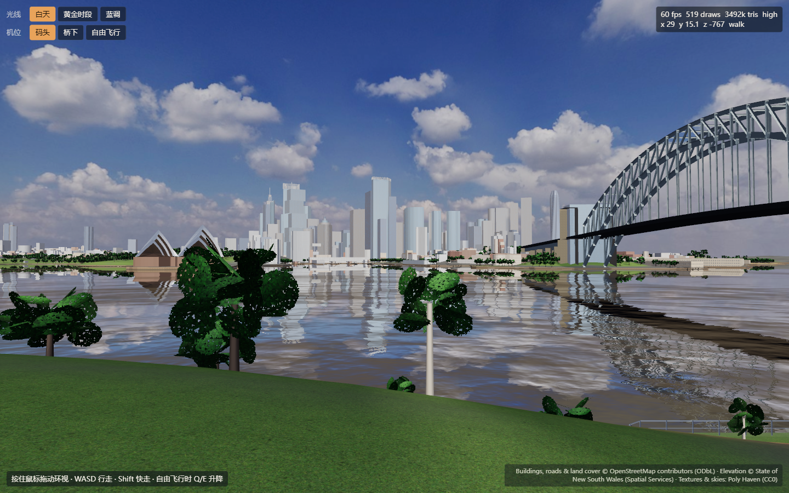

# 此间 · 悉尼港高质量场景制作交接

日期：2026-11-03，Asia/Shanghai。读者：接手的 Blender 建模人员、场景美术、Three.js 开发人员及协助实现的 Agent。

本文交接当前工程、用户目标、实际问题、推荐改法与验收方式。本文中的制作任务为下一阶段建议，不表示已实现；路线范围、人员分工、工期与最终展示设备尚未由用户确认。执行前核对所在分支和未提交修改。

## 1. 接手后先读这段

用户需要高质量、有审美、符合真实地点的沉浸式文化旅行体验。希望能进入、探索、停留、观察当地生活并自主拍照。视觉方向为“写实、经过审美化处理的电影感”。用户明确不满意当前的卡通感、材质平、建筑重复、水面不真实，并希望夜晚有内透。

下一轮最重要的交付：**先恢复可靠的建筑立面显示，再完成一个可走近的高质量样板，使建筑、岸线、植被、水面和昼夜光照达到一致质量。** 不能用“增加了多少栋建筑、多少个材质、多少行着色器”替代实际画面验收。

本轮新结论：2026-11-03 已在浏览器实际进入最新版白天场景，高、低画质均能显示。此前交接的“90 秒加载超时”是历史记录；本次没有复现同样的加载阻塞。但建筑立面仍大面积近似浅色白模，窗格、颜色和材料层次明显不足。**根因尚未定位，不能直接归因于某一段着色器，也不能声称新内透已通过验收。**

建议的第一项任务是本文 T01。不要先扩张城市、批量下载贴图或重建全场景。

## 2. 仓库、版本与工作边界

| 项目 | 已核实信息 |
|---|---|
| 实际 GitHub 仓库 | <https://github.com/luzh06/nailong> |
| 悉尼分支 | `sydney-harbour`，场景工程位于该分支根目录 |
| 本文检查基线 | `502af7e01d232c1fd291890bf7add4686ed7f134` |
| 原始源工程最新提交 | `73470531d30c96f0107074cc8157e5c93d2c307f` |
| 原始制作目录 | `D:\project\cijian\sydney`，本地分支 `main` |
| 本次独立上传与检查副本 | `D:\project\chatgpt\ci\sydney-review`，分支 `sydney-harbour` |
| 原始模型 | `blend/sydney_blockout.blend` |
| 网页运行模型 | `web/data/blockout.glb` |
| 历史实查 | [2026-11-02 报告](../review/research/悉尼场景实查与升级方案_2026-11-02.md) |
| 上传清单 | [docs/upload-manifest.json](../upload-manifest.json)，阅读其中的范围与日期 |

截至上述检查基线，已上传五个源工程提交及一个归档文档提交，共 181 个文件，GitHub 提交和 tree 曾与本地逐项核对。本文及其附图属于随后新增的交接资料；不能把 181 当作后续版本永远不变的总数。

不要继续使用不存在的独立仓库地址 `luzh06/sydney-harbour`。正确的是 `luzh06/nailong` 仓库中的 `sydney-harbour` 分支。该分支与仓库主分支的工程布局不同，不要直接把它当作东京工程目录覆盖主分支。

工程已具有可独立运行的自有模型模式。Google 混合模式是已有可选实验代码，未用真实 Key 完成验证。制作目标优先保障自有模型模式；不要把新增服务 Key 设为基础体验必需条件。

## 3. 用户目标与建议范围

### 3.1 已明确的要求

- 真实地点有辨识度，建筑、地貌、文化与生活有依据。
- 高审美应体现在可游玩的实时场景中，近看、转身、移动时仍然可信。
- 建筑具有不同的体块、层数、立面节奏和材料。
- 材质能表现不同表面在同一光照下的差异。
- 夜间具有可感知的室内空间与合理灯光。
- 水面、植被、岸线和环境整体自然。
- 核心体验包括自由探索、当地生活与文化、自主拍照；仅有概念图或自动镜头不足以完成目标。

### 3.2 本文建议的首个制作范围

先选北岸一段真实可走的滨水区域，以歌剧院、CBD、海港大桥作为对岸景观。可以从约 150–300 m 的步行段中选取首个完整样板，长度是制作建议，并非已经批准的范围。具体边界依据现有 `walkZone`、真实地理和可制作内容确定。

建议包含：一段步道、草地与树、一组栏杆或海堤、一处可停留设施、一个水边观察点、一栋能明确体现材质与内透的样板建筑，以及对岸主要天际线。样板建筑可以单独设测试机位，不应为展示而任意移动真实建筑。

北岸与南岸有真实地理距离。不要把歌剧院入口、南岸街巷等元素拼到北岸步行段；若制作南岸，应作为真实路线或独立场景处理。

### 3.3 下一阶段暂不扩大的内容

暂不以全城高精度、所有建筑可进入、全城实时室内灯、多种天气与完整交通系统为第一轮门槛。先用一个完整样板证明质量，再制定扩展计划。未来文化任务、拍照、回忆卡等仍保留在产品目标中，按阶段接入。

## 4. 当前真实状态

| 内容 | 当前状态 | 接手时应如何理解 |
|---|---|---|
| OSM 建筑与岸线、NSW 高程 | 已有数据、处理脚本与输出 | 部分建筑高度是类型默认值，数据定位不等于美术已完成 |
| 大桥与歌剧院 | 已有参数化模型及早期校准记录 | 仍缺若干近景结构，需逐机位复核 |
| 特征楼 | 已写入生成脚本并重建模型 | `landmarks.py` 标注尺寸近似，需参考资料校准 |
| 程序立面与室内映射 | 新代码已提交 | 最新实测立面细节不足，内透尚未通过视觉验收 |
| 墙面法线、海堤湿痕 | 新代码已提交 | 不能重复说“所有立面都完全没接法线”；当前仍需查实际效果与材质分类 |
| 岸线水面与距离图 | 新代码已提交 | 距岸颜色、泡沫是近似；实际画面仍有明显镜面与重复扭曲感 |
| 码头与栏杆 | 已批量生成 | 数量不能证明类型、位置、尺度与结构正确 |
| 树 | 已有大量卡片树 | 当前近景拼片与树形重复明显，未完成高质量近景替换 |
| 行走、飞行、时段切换 | 已有实现 | 本次主要检查白天加载，未全流程复验碰撞与所有时段 |
| 拍照与文化互动 | 悉尼入口尚未完成接入 | 仓库其他分支有模块不代表已进入悉尼体验 |
| 全流程性能 | 未完成目标设备测量 | 浏览器瞬时 fps 和旧 README 数字不能当发布承诺 |

### 4.1 版本历史简表

| 提交 | 内容 |
|---|---|
| `b36a119` | 地理白模、地形、地标和网页入口 |
| `b69484c` | 早期材质、HDR 天空、阴影、植被、水面及夜景 |
| `68cedfa` | Google 混合模式；此前四张截图的版本 |
| `1ad3bf8` | 地标楼、室内映射、岸线水面与设施质量样板代码 |
| `7347053` | 补充历史截图超时交接 |
| `502af7e` | 完整上传归档、旧版四张截图、实查报告及说明 |

## 5. 最新运行证据与限制

检查条件：本机 HTTP 服务，`layers=own`、`time=day`、`still=1`；画幅 1440×900；分别检查默认高画质与 `q=low`。截图无图像生成、无后期美化。`still=1` 冻结水面，本证据不能证明动态水面已经自然。



[低画质对照](evidence/latest-day-low.png)。旧版基线分别见 [白天](../review/sydney-day.png)、[黄金时段](../review/sydney-golden.png)、[蓝调](../review/sydney-blue.png)、[CBD](../review/sydney-cbd.png)。旧图来自 `68cedfa`，禁止与本次图混称同一版本。

本次实际观察：

1. 加载提示消失，场景可显示；两档画质都能看到模型。
2. 未捕获页面异常或显式着色器编译错误；存在资源 404，已知工程会尝试载入可选 `config.local.js`。接手时应通过 Network 核对具体缺失 URL，不要把所有 404 都忽略。
3. 在网络空闲后重截，高楼外墙仍大面积接近白模，未恢复预期立面细节。不是仅凭加载中的首帧下结论。
4. 树冠拼片、单一直树干、前景草坪层次不足、水面倒影重复扭曲仍可见；右侧桥底有大块暗面。
5. 最新蓝调、黄金时段、室内映射侧移、动态水面、碰撞、所有浏览器与较弱设备尚未完成本轮验收。
6. 截图叠加层出现过不同瞬时 fps。未记录完整硬件、预热、持续帧耗时与后台限帧条件，不据此声称性能稳定或作跨版本性能比较。

## 6. 美术方向与质量标准

### 6.1 推荐视觉方向

明亮通透的海港、克制的材料色彩、有生活气息的岸边空间。真实尺度和材料关系是基础；电影感来自光线、明暗层次、构图与游玩节奏。

- 白天：天空、水体和建筑有空气感；白色屋面亮处保留纹理与体积。
- 黄金时段：受光面适度暖，阴影保留冷色；太阳、天空与反射方向合理。
- 蓝调：天空与水面有层次，少量室内暖光形成视觉重点，建筑暗部可读。
- 材料关系：白色瓷砖、砂岩、灰蓝玻璃、灰色结构、蓝绿海水、自然植被彼此协调。
- 自由观看：主机位有吸引力，沿路转身、低头、走近也没有明显布景破绽。

避免用高饱和绿树、统一泛黄、强泛光、过曝白屋面、大面积纯黑、过度镜面反射来营造“高级感”。避免用夸张景深和模糊遮盖低质量资产。

### 6.2 制作精度分配

| 区域 | 模型重点 | 材质与表现 |
|---|---|---|
| 近景可接近区 | 台阶、路缘、窗洞、框、栏杆、海堤、树干具有真实厚度 | 可读表面细节、接缝、局部磨损、接触阴影；避免重复大花纹 |
| 中景主要建筑 | 正确体块、退台、裙房、冠部、主要竖肋 | 稳定的窗格与材料分区，内透具有适量视差 |
| 远景城市 | 天际线、主要高度与建筑群关系 | 抗闪烁、控制反射与亮窗平均值，简化室内与小构件 |

真实距离和画面像素占比共同决定精度，不为所有建筑固定分配相同面数和贴图尺寸。

## 7. 工程入口与模块责任

下列路径均相对悉尼分支根目录。

| 文件/目录 | 用途 | 修改关联 |
|---|---|---|
| `README.md`、`HANDOFF.md` | 运行与历史交接 | 后续结果更新时同步，旧结论标明版本 |
| `data/osm_*.json` | 原始地理输入 | 保留原始文件和来源；不要靠手改原数据解决画面问题 |
| `scripts/prep_osm.py`、`data/scene.json` | 地理清理、建筑高度与类型 | 默认高度需要被标记和逐步校准 |
| `scripts/terrain.py`、`data/nsw_dem_4m.tif` | 高程采样 | 坐标与地形为全场共同依据 |
| `scripts/ground.py`、`scripts/meshkit.py` | 地面、一般建筑、网格与米制 UV | 建筑属性、法线、UV 与网页着色器保持一致 |
| `scripts/landmarks.py` | 特征楼 | 体块、位置、高度与冠部需有参考证据 |
| `scripts/opera.py`、`scripts/bridge.py` | 歌剧院、大桥 | 近景结构与校准；保留现有地理关系 |
| `scripts/foreshore.py` | 码头与栏杆 | 核对空间类型、落地位置和碰撞影响 |
| `scripts/build_landcover.py` | 地表图、树数据、距岸图 | 输出与坐标范围联动 |
| `scripts/build_blockout.py` | 组装并导出 | 会重写 Blender、GLB、元数据，手工细节须设计保留机制 |
| `blend/sydney_blockout.blend` | Blender 场景 | 可能被重建脚本覆盖，不应只有此文件保存手工成果 |
| `web/data/blockout.glb`、`scene_meta.json` | 运行模型、机位和行走元数据 | 模型、元数据、材质属性需版本一致 |
| `web/src/main.js` | 场景加载、时段和模式接入 | 检查加载完成条件及错误反馈 |
| `web/src/materials.js` | 材质替换、CSM 和补丁串接 | 立面显示故障主要排查入口之一 |
| `web/src/shaders/facade.js` | 立面样式、窗框、内透、远景过滤 | 与 `/16` 风格编码、`bstyle`、UV、法线契约一致 |
| `web/src/textures.js` | 颜色空间、PBR 贴图、米制缩放 | `diff` 与法线/ARM 不使用相同颜色空间 |
| `web/src/environment.js`、`post.js` | 时段、天空、阴影、曝光与后期 | 调整应在固定机位和统一输出条件下进行 |
| `web/src/water.js` | Water 着色器补丁与岸线表现 | 字符串替换依赖 vendor 版本，必须测试失败反馈 |
| `web/src/vegetation.js`、`web/data/trees.json` | 树的生成与布置 | 近景替换和距离层级 |
| `web/src/player.js` | 行走、飞行、边界和地面跟随 | 新近景设施需额外核对碰撞 |
| `web/src/lights.js`、`tiles.js` | 桥灯、Google 可选模式 | 不能把试验模块当默认体验依赖 |
| `web/assets/ASSETS.csv` | 来源与许可记录 | 替换或新增资产时同步 |
| `tools/review_shots.js` | 固定机位截图函数 | 含旧电脑临时输出路径与 8770 端口，运行前调整 |

坐标：单位米，原点在歌剧院。Blender 为 X 东、Y 北、Z 上；网页为 X 东、Y 上、负 Z 北。转换应统一，禁止为修复某个物体单独反转整个世界。

建筑风格属性约定：`bstyle` 来源为模型颜色属性，包含随机种子、`(style + 0.5) / 16` 与高度归一化信息。旧版曾使用 `/8`，混用新旧模型和着色器会产生风险。这里是排查项，不是本次已确认根因。

## 8. 任务顺序与具体交付

建议阶段：T01 → T02/T03 → T04/T05/T06/T07 → T08 → T09/T10。一个文件或模块同时只安排一个主写者。下列职责是分工建议，没有虚构已指派成员或承诺工期。

### T01 · 恢复立面显示，建立可信基线（最高优先级）

主责：Three.js 开发。输入：当前固定机位、`68cedfa` 历史画面、最新 GLB 与材质代码。

步骤：

1. 在独立工作副本复现高、低画质，记录控制台、Network、缺失材质名、模型和着色器版本。
2. 把 `68cedfa` 放在另一个目录并使用相同机位、画幅与时段对照；不在当前分支盲目回退。
3. 用单栋建筑或小测试网格验证材质替换是否命中、`bstyle` 数值是否正确、米制 UV 是否存在、墙/屋顶法线分类是否正常。
4. 逐项显示纯色、样式 ID、UV 网格、法线、窗格遮罩、内透输出等调试结果，每次只改变一个变量。
5. 分离测试 CSM 补丁、`onBeforeCompile` 串接、颜色、法线、粗糙度与自发光，记录哪一项使结果改变。
6. 找到最小根因后修复；运行小场景检查并回到完整场景对照。排查中新增的调试 UI 不进入正式用户画面。

验收：高低画质均恢复可读立面；墙/窗/屋顶分类正确；新增特征楼使用正确样式；无着色器或页面异常。交付根因说明、改动文件、对照截图及可复现入口。加载成功不能代替此项验收。

### T02 · 建立参考资料与场景清单

主责：场景美术，开发配合坐标定位。

为可走区域、主要地标和样板建筑建立参考板：地图位置、观看方向、不同角度照片、可查尺寸、材料特写、日夜照片。每条记录来源 URL、拍摄方向、日期/年代、是否可用于发布。参考照片与可再分发纹理分开管理，不能把网页上可见照片直接作为可发布素材。

建议登记字段：资产 ID、真实名称、坐标、近/中/远景、主要机位、来源、哪些尺寸为估计、制作状态、制作者、文件路径、验收证据。版本化保存原始输入与生成参数。

验收：主要建筑在模型前就能明确参考依据；缺失数据标为估计；北南岸及各建筑的真实关系不被改乱。

### T03 · 完成首个可走质量样板

主责：场景美术与整合开发。

先确定边界与机位。完整制作步道—路缘—草地—树—停留设施—栏杆/海堤—水面的空间连接，并配一栋能演示立面、材料和室内空间的建筑。对岸保留主要景观。

场景要有合理尺度、地面跟随、边缘安全和路线可读性。栏杆落在实际地面上，道具不悬浮；排水、台阶、接缝与材料交界有因果关系。树木位置要符合真实参考，不以遮挡低质量模型为布置原则。

验收：从固定机位好看，沿路移动和转身也可信；正视、侧视和低头看地面均没有明显穿插、漏底、重复或突变。

### T04 · 校准主要建筑与地标

主责：Blender 建模。

- 从主要机位可见建筑中选约 5–8 栋重点制作，数量为建议；先核对轮廓、位置、高度、宽深、旋转、退台与裙房，再补窗格。
- `landmarks.py` 中 Crown、Quay Quarter、Australia Square 等近似参数逐项有依据地修订。不得凭记忆“更像”就完成。
- 歌剧院补壳体厚度、边缘、可见肋线、玻璃支撑与内退空间、基座台阶及入口；维持已建立的球面逻辑并重新核对轮廓。
- 大桥检查主结构关系、可见连接节点、桥面边缘、扶栏、桥塔石材；桥底暗面先查法线、背面与照明，避免直接大幅抬亮整个场景。
- 一般背景楼使用受约束的模块变化，依据用途/年代组织窗宽、层高、屋顶、阳台和退台，固定随机种子。

手工高质量资产建议独立保存源文件/集合并由组装脚本引用，或以明确的生成参数保存。不要把手工修改只留在下一次重建会覆盖的 `sydney_blockout.blend` 中。

验收：能把模型和匹配机位参考叠放检查；关键轮廓不再同质化；新增部分不会下次重建消失。提交 `.blend` 源、网页资产、参考与参数记录。

### T05 · 完成材料体系与近景细节

主责：材质美术，开发配合着色器。

| 表面 | 具体制作重点 |
|---|---|
| 砂岩/海堤 | 石块尺度、灰缝、边缘、湿润范围、藻类变化；不做完全统一的水平脏线 |
| 玻璃 | 与窗框分区；正视和掠射角反射有区别；透入室内的程度合理，避免用接近金属的全局参数硬凑效果 |
| 金属 | 区分喷漆金属、裸露金属与镀层，校正粗糙度、边缘与固定件 |
| 混凝土/抹灰 | 施工缝、板缝、有限强度的起伏和边缘细节，避免把所有墙都套成同一种混凝土 |
| 木材 | 板宽、端头、缝、固定件、褪色与潮湿，按实际码头类型选择木/混凝土/钢 |
| 地面 | 铺装尺度与方向、路缘、排水和修补；草地与步道之间有自然边界 |

技术要求：颜色图使用正确颜色空间；法线和 ARM 按数据纹理处理；核对法线方向、AO 通道和 UV；粗糙度有真实表面变化。纹理细节、几何轮廓和阴影各负其责。窗框、台阶、栏杆与可接近边缘的厚度需要由模型承担。

验收：先在中性光、较低泛光下检查，同一束光下不同材料具有不同响应；随后放入三时段。不能以贴图“4K/8K”标签作为质量证明。

### T06 · 夜间内透与灯光

主责：渲染开发与灯光美术。

现有室内映射必须先通过 T01 验证。近景用有深度的浅房间、楼板、墙、窗帘和少量家具；中景使用有视差的室内映射；远景用稳定的亮窗图集/平均值。

按住宅、办公室与公共建筑组织房间和楼层状态：保留连续暗楼层、不同窗帘状态与克制的色温变化；不要每扇窗完全独立随机。室内可用自发光表达可见亮度；需要照亮室外地面时，额外使用受控灯光、烘焙或局部近似，不能假设自发光材质会自动照亮周围。

验收：相机侧移和仰视可感知房间深度，房间不突然跳变；远景不闪烁；窗框和玻璃没有一起过曝；先降低泛光校准亮度，再加适量光晕。歌剧院玻璃整体发光仍需单独检查。

### T07 · 水体、岸线与倒影

主责：渲染开发，场景美术配合。

当前是大平面 Water、平面反射和滚动法线，加上距岸贴图。已经改过反射基础参数和扰动，不应只重复修改同一数值。

步骤：先调水体颜色和反射平衡，再建立统一风向的大尺度起伏与细波；针对实际画幅测试倒影分辨率、模糊与扰动；区分海堤、沙岸、岩岸、码头下方；最后加入少量可信船只与尾迹。

**距岸不等于水深。** 深水码头边不能机械地套浅绿带；没有可靠水深时按岸线类型做克制近似并注明。泡沫应在合理位置随波变化，避免所有岸线整圈白边。夜间灯光倒影应有方向与连续性。

验收：静态和运动都没有显眼的重复拉扯纹；正视远水、掠射角与低头近水都合理；岸边过渡无硬色带；水面反射质量和成本有记录。必须去掉 `still=1` 录制动态测试。

### T08 · 植被、天空、光照和整体审美

主责：场景美术与灯光美术。

近景替换少量高质量树，表现树种、枝干分叉、树冠结构、树皮与叶片透光；中景使用优化卡片树，远景用简化体/广告牌。资产选型依据效果、可编辑性、许可和性能，现有交接中的第三方库名称仅为历史建议，尚未选定。

植被布置核对真实位置、密度与尺度；处理草地过于均匀和边缘生硬的问题。风动幅度克制，避免全场同频摆动。

统一曝光、背景亮度、雾、太阳方向、阴影、材质与后期。黄金时段当前天空太阳高度与主灯高度存在人为调整，需核对其视觉一致性。蓝调保留城市暗部，白天防止白屋面过曝；不要全靠增加环境光消除结构问题。

验收：三时段均有明确视觉层次；树不再成为最显眼的低质量前景；主机位与沿路观看统一，无明显雾色断层或黑块。

### T09 · 生活、文化与拍照接入

主责：体验开发与内容人员，在样板视觉稳定后接入。

少量合理活动即可建立生活感：沿真实路线行走与停留的人、渡轮、水声、脚步声和远近环境声。人物尺度、材质和动画要与写实环境匹配，避免大量重复静止人偶。

选一处有来源的当地生活/文化观察点，连接一次轻互动或选择，再进入自主拍照。相片应保存玩家真实选择的视角和时段；回忆内容关联实际经历。其他分支的拍照模块接入前先核对接口和所有权，不能假定已可直接使用。

验收：玩家能自主走、看、选择与拍照；操作提示克制；路线有停留节奏；文化信息有来源，原创对白不伪装成真实人物史料。

### T10 · 性能、重建与交付

主责：整合开发。

在目标设备上记录浏览器、GPU、分辨率、DPR、质量设置、阴影与反射设置。建议以稳定 30 fps 为初步底线、60 fps 为更理想目标；这是待目标设备确认的建议，不是当前性能承诺。记录连续行走和转身时的帧耗时、卡顿与内存，不能只取一个瞬时 fps。

按建筑/地形空间块组织剔除和距离层级；复用材质、纹理图集与可实例化构件；控制水面额外渲染与阴影成本。不要为减少绘制调用把整座城市永久合成一个无法剔除、选择或替换的大对象。几何压缩、纹理压缩和层级优化在资产质量确认后做，并验证解码与视觉差异。

验收：新电脑可按说明启动；能从源资产重建并找到输出；基础体验不依赖私密 Key；无必需资源 404；错误可见；新增手工成果可保留；交付源文件、运行资产、参数、来源和证据。

## 9. 启动与重建

### 9.1 获取正确分支

新目录中执行：

```powershell
git clone --branch sydney-harbour --single-branch https://github.com/luzh06/nailong.git sydney-harbour
Set-Location .\sydney-harbour
git status --short
git log -6 --oneline
```

已有工作目录先检查分支、remote 和未提交修改，再选择同步方式。不要使用强制覆盖、`reset --hard` 或删除他人文件作为例行更新步骤。

### 9.2 本机运行

在悉尼工程根目录，若有正常 Python 3：

```powershell
python -m http.server 8772 --bind 127.0.0.1 --directory web
```

本次机器可用的解释器替代命令：

```powershell
& 'D:\Cijian\tools\blender-5.2.3-windows-x64\5.2\python\bin\python.exe' -m http.server 8772 --bind 127.0.0.1 --directory web
```

访问 <http://127.0.0.1:8772/?layers=own&time=day>。该端口只是本次使用值；被占用时换端口并同步所有测试 URL。不能使用 `file://` 替代 HTTP。不要为只预览网页而重复下载素材或重建模型。

### 9.3 重建与手工资产保护

先建立可回退版本并确认手工资产保存方式。下列命令按现有 README 和脚本入口整理，本轮没有重新执行全套重建，接手者须实测。安装路径需适配实际机器；当前 README 的依赖重建主要使用 shapely、pillow，脚本另使用 Blender 自带 numpy 等模块，缺失时按实际错误核对。

```powershell
$sydneyBlender = 'D:\Cijian\tools\blender-5.2.3-windows-x64'
& "$sydneyBlender\5.2\python\bin\python.exe" -m pip install --target .pydeps shapely pillow
& "$sydneyBlender\5.2\python\bin\python.exe" scripts\prep_osm.py
& "$sydneyBlender\5.2\python\bin\python.exe" scripts\fetch_assets.py
& "$sydneyBlender\5.2\python\bin\python.exe" scripts\build_landcover.py
& "$sydneyBlender\blender.exe" -b --factory-startup -P scripts\build_blockout.py
```

`fetch_assets.py` 涉及下载；已有资源完整且不变时，不要无故重新下载。重建将写入 `blend/` 与 `web/data/`，并更新地表、树和岸线相关输出。保留日志并比较重建前后差异；不要仅凭 Blender 退出码为 0 就判定场景质量通过。

## 10. 固定机位与检查方法

统一使用自有模型模式。下列参数来自现有 README/截图工具；其中部分为飞行诊断机位，不能当作已验证可步行位置。

| 名称 | 参数（追加到 `http://127.0.0.1:8772/?layers=own`） |
|---|---|
| 出生主机位 | `&time=day&still=1` |
| CBD 中景 | `&time=day&still=1&cam=-260,60,-150&look=-300,60,450&fov=50` |
| 天际线长焦 | `&time=day&still=1&cam=28,15,-767&look=-420,110,700&fov=22` |
| 夜间立面 | `&time=blue&cam=-250,40,-200&look=-420,60,640&fov=30` |
| 岸线 | `&time=day&cam=40,16,-760&look=-40,4,-735&fov=55` |
| 近水 | `&time=golden&cam=-150,8,-600&look=-330,0,-180&fov=55` |
| 桥 | `&time=golden&cam=-200,30,-560&look=-450,60,-380&fov=55` |
| 航拍边界检查 | `&time=golden&cam=200,700,-1800&look=-200,0,0&fov=50` |

每轮固定版本、机位、FOV、画幅、DPR、时段和质量设置，待资源网络空闲与渲染稳定后截图。保留有统计叠加层的证据，另导出干净展示画面；不得裁掉或美化实际缺陷冒充改进。水面静态比较可用 `still=1`，动态另录短片。

`tools/review_shots.js` 是接收 Playwright `page` 的函数，不是已配置的独立测试命令。先替换其中临时目录，确保输出目录存在，核对端口，使用能传入 `page` 的执行环境运行。它当前会过滤部分 404 日志，接手检查应另外保留完整网络失败记录。

`bench=1` 会开放 `window.__bench(n)`；同步渲染并回读像素可用于比较 GPU 成本，但仍需与正常游玩帧耗时配合，不能单独作为体验验收。

## 11. 最终验收清单

### 11.1 视觉与资产

- [ ] 修复并解释当前立面大面积白模感；高低画质均有证据。
- [ ] 主要建筑有参考、正确轮廓和不同立面节奏；估计尺寸明确标注。
- [ ] 近景框、台阶、栏杆、海堤有厚度，接地和比例正确。
- [ ] 同一光照下能区分玻璃、石、木、金属和混凝土。
- [ ] 夜间侧移可感知室内空间；亮暗有组群，远处不闪烁。
- [ ] 水面运动、反射与岸边过渡自然，无显眼的重复扭曲和整圈白边。
- [ ] 近景树干、树冠和叶片经得起观看，前景布置不破坏真实地理。
- [ ] 日、黄金、蓝调均可读，白屋面不过曝，暗部没有不合理黑块。
- [ ] 移动、转身、俯视与飞行检查没有明显漏底、穿插和背面破绽。

### 11.2 体验与工程

- [ ] 能在说明所列的新环境启动，所有必需资源加载成功。
- [ ] 行走、地面跟随和设施碰撞正确，无穿栏杆/跳地/出界。
- [ ] 至少一段路线可观察、停留，并完成一次自主拍照体验。
- [ ] 文化信息来源清楚，原创与事实可区分。
- [ ] 目标电脑记录完整；正常游玩和转身的性能达到约定标准。
- [ ] 源资产、脚本、运行输出、参数、来源和证据齐全。
- [ ] 重建不会丢失新增手工资产；能定位出问题的具体模块和版本。
- [ ] 更新 README/交接/素材登记，检查提交内容和远端提交一致。

## 12. 工作与交付约定

建议分为建模与场景、材质与灯光、开发与整合三类责任，具体人员待团队指定。同一模块只设一个主写者，审查反馈交给主写者处理；其他人不回滚未理解的改动。

每次领取任务记录：任务 ID、输入基线、负责文件、会重写的输出、预期画面变化、验证方式。每次交付记录：提交 SHA、完成内容、未完成内容、真实截图/视频、运行与重建方式、设备与性能条件、下一个阻塞点。

所有模型与素材保留可编辑源；新增素材登记作者、原始来源、许可和处理记录。现有 NSW 高程许可存在待确认事项，继续保留其记录，不能把上传仓库等同于已完成商业发行许可核验。不要把私密 Key、`.pydeps`、缓存或浏览器登录数据加入仓库。

建议资产目录可在实际整合时设为独立的高质量源资产目录，并输出到网页资产目录；先确定脚本的引用方式再移动文件。本文不要求为了统一外观而重构整个目录或迁移引擎。

## 13. 资料来源与仍待决定事项

项目目标依据：现有此间需求文档及本次聊天中的用户要求。此前东京归档仓库保存的 `docs/context/requirements.md` 可作历史上下文，但不覆盖用户对悉尼的后续决定。

建议核对的技术与建筑资料：

- [歌剧院官方：球面解法](https://www.sydneyoperahouse.com/our-story/the-spherical-solution)
- [歌剧院官方：保护管理资料](https://www.sydneyoperahouse.com/sites/default/files/collaborodam_assets/soh-cmp-interactive-1.pdf)
- [Three.js 标准材质](https://threejs.org/docs/pages/MeshStandardMaterial.html)
- [Three.js 物理材质](https://threejs.org/docs/pages/MeshPhysicalMaterial.html)
- [Three.js 水面示例](https://threejs.org/examples/?q=water)
- [Three.js 多物体优化](https://threejs.org/manual/pages/optimize-lots-of-objects.html)

仍待决定：首个精做岸段的准确范围与建筑清单；具体美术参考板；当前期限与人员；展示设备、浏览器及分辨率；是否保留自由飞行为正式功能；文化互动与拍照模块整合范围。上述缺项不妨碍先完成 T01 和参考整理，也不应通过臆造决定填补。

**接手者的第一份成果应是：能复现的立面问题说明、最小修复与同机位对照。第二份成果是一个完整可走的质量样板。通过样板后再扩大制作范围。**
